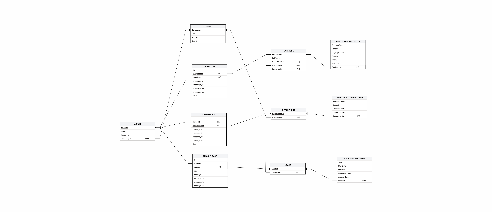
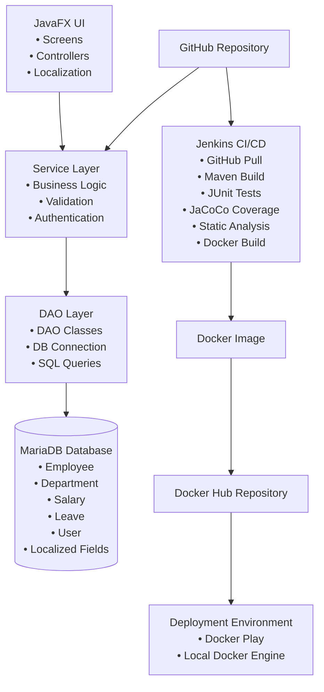

# 1. Project Title & Overview

## Employee Management System

Managing employee information through spreadsheets often leads to data loss, duplication, inconsistent records, and difficulty handling large datasets. As organizations grow, manual HR processes become inefficient and error‑prone.

The **Employee Management System** is an end‑to‑end Java‑based application designed to centralize HR operations, improve data accuracy, and streamline administrative workflows. It enables companies to manage employees, departments, salaries, leave records, and audit logs through a structured, secure, and scalable system.

The system is built using a full‑stack Java architecture (JavaFX, Java backend, MariaDB), supported by modern DevOps practices such as CI/CD, Docker containerization, and automated testing.  
The project was developed over **8 sprints (16 weeks)** following Agile/Scrum methodology.

---

# 2. Product Vision

The Employee Management System exists to replace inefficient, error‑prone spreadsheet‑based HR workflows with a centralized, reliable, and scalable digital solution. The system provides companies with a structured platform to manage employees, departments, salaries, leave records, and administrative changes while ensuring data accuracy and operational transparency.

## Vision Statement
A unified HR management platform that empowers organizations to maintain accurate employee data, automate administrative tasks, and support informed decision‑making through structured workflows and real‑time insights.

## Main Goals of the System
- Centralize all employee‑related information in a secure and structured environment.
- Reduce manual work and eliminate data duplication or inconsistencies.
- Provide intuitive tools for managing departments, salaries, and leave records.
- Enable real‑time dashboards and analytics for better decision‑making.
- Ensure full traceability of administrative actions through audit logs.
- Support multilingual and multicultural organizations through UI and database localization.

## Key Features
- Company and admin registration
- Secure login and authentication
- Employee, department, salary, and leave management
- Dashboard with real‑time statistics
- Audit logging for all administrative changes
- Full UI localization (EN, ES, FA, AR)
- Database‑level localization for multilingual data
- CI/CD pipeline with automated testing and code quality checks
- Dockerized deployment for consistent environments

## Definition of Success
The project is considered complete when:
- All core HR features are fully implemented and functional.
- The system supports multilingual UI and database content.
- CI/CD pipeline (build, test, coverage, static analysis) runs successfully.
- The application is fully containerized and deployable via Docker.
- All sprints (1–8) are documented and linked in the repository.
- Final documentation, diagrams, and testing reports are complete and accessible.

---

# 3. Project Plan & Sprint Structure

The project followed an Agile/Scrum development methodology, with iterative delivery, continuous feedback, and incremental refinement of features. Each sprint lasted **2 weeks**, resulting in a total project duration of **8 sprints (16 weeks)**.

## Development Methodology
- **Approach:** Agile / Scrum
- **Sprint Length:** 2 weeks
- **Artifacts Produced:** Sprint Planning Reports, Sprint Review Reports, Backlog updates, Burndown tracking
- **Tools Used:** Trello (Sprint boards), GitHub (Version control & documentation), Jenkins (CI/CD)

## Overview of All 8 Sprints

| Sprint | Focus Area | Summary of Goals |
|--------|------------|------------------|
| **Sprint 1** | Project Planning & Vision | Team formation, product vision, project plan, backlog creation, technology selection |
| **Sprint 2** | Requirements & Database | Database schema design, ER diagram, CRUD operations, initial UI screens, unit testing setup |
| **Sprint 3** | UI Implementation & CI | Full UI scenes, authentication, backend integration, Jenkins CI/CD pipeline, Docker prototype |
| **Sprint 4** | Docker Containerization | Finalize prototype, create Docker image, push to Docker Hub, test deployment, finalize documentation |
| **Sprint 5** | UI Localization | Externalize UI text, implement multilingual UI (EN/ES/FA/AR), RTL support, dynamic switching |
| **Sprint 6** | Database Localization | Add multilingual DB support, update ERD, static code analysis, refactoring, acceptance test planning |
| **Sprint 7** | Quality Assurance | Functional & non-functional testing, UAT, heuristic evaluation, SonarQube analysis, bug tracking |
| **Sprint 8** | Documentation & Finalization | Final README, architecture diagrams, sprint links, final presentation, repository cleanup |

Each sprint will have its own subsection later in the README, including links to the Sprint Planning and Sprint Review reports.

---

## 4. Sprint 1 – Project Planning & Vision

Sprint 1 focused on establishing the foundation of the Employee Management System. The team defined the product vision, created the initial project plan, selected the technology stack, and set up all project management tools required for development. The initial product backlog was created, and the project scope and risks were clarified.

### Summary of Work Completed
- Team formation and communication setup
- Selection and validation of the project topic
- Creation of the Product Vision document
- Development of the Project Plan
- Technology stack selection (Java, JavaFX, MariaDB, Maven, GitHub, Trello)
- Setup of Trello workspace and GitHub repository
- Creation of the initial Product Backlog
- Preparation of the Sprint 1 presentation
- Optional early UI design and database sketches

### Links to Sprint Documents

- **[Sprint 1 Planning Report](https://github.com/Jesperho/Employee-Management-System/blob/main/docs/sprint_report/Sprint%201/Sprint_1_Planning_Report.md)**

- **[Sprint 1 Review Report](https://github.com/Jesperho/Employee-Management-System/blob/main/docs/sprint_report/Sprint%201/Sprint_1_Review_Report.md)**

---

## 5. Sprint 2 – Requirements & Database

Sprint 2 focused on defining the system requirements and implementing the first version of the database. The team designed the ER diagram, created the relational schema, implemented CRUD operations, and developed the first functional UI screens. Unit testing and code coverage were also introduced during this sprint.

### Summary of Work Completed
- Defined functional requirements for core system features
- Designed the Use Case Diagram and ER Diagram
- Implemented the MariaDB database schema with all required tables and relationships
- Verified CRUD operations for key entities (Employee, Department, Leave, Salary)
- Developed initial JavaFX UI screens (Login and Dashboard)
- Integrated JUnit for unit testing
- Configured JaCoCo for code coverage reporting
- Prepared Sprint Review demonstration (database, UI, tests, coverage)

### Sprint Artifacts
- **[Use Case Diagram](https://github.com/Jesperho/Employee-Management-System/blob/main/docs/Diagrams/UseCase_Diagram.JPG)**
- **[ER Diagram](https://github.com/Jesperho/Employee-Management-System/blob/main/docs/Diagrams/ER_Diagram2.png)**
- **Unit testing setup (JUnit + JaCoCo)**

### Database Schema Implementation

**Technology:** MariaDB (Relational Database)
**Rationale:** The data managed by this system (Employees, Departments, Leave...) is highly structured and formalized. According to data modeling principles, a **Relational Database** is the correct choice for structured data where integrity and consistency are critical. A relational model allows us to implement the ER diagrams and cardinality constraints (e.g., 1:M relationships) designed in the logical design phase.

The relational schema represents the physical database structure in MariaDB.
It includes primary keys, foreign keys, and table relationships for all entities in the system.

### Links to Sprint Documents
- **[Sprint 2 Planning Report](https://github.com/Jesperho/Employee-Management-System/blob/main/docs/sprint_report/Sprint%202/Sprint_2_Planning_Report.md)**
- **[Sprint 2 Review Report](https://github.com/Jesperho/Employee-Management-System/blob/main/docs/sprint_report/Sprint%202/Sprint_2_Review_Report.md)**

---

## 6. Sprint 3 – UI Implementation & CI

Sprint 3 focused on extending the functional prototype by implementing the full graphical user interface, integrating the backend with the UI, adding authentication and authorization, and establishing a complete CI/CD pipeline using Jenkins. The team also created the first Docker image of the application and expanded unit and coverage testing.

### Summary of Work Completed
- Implemented full JavaFX UI scenes:
    - Employee Management
    - Department Management
    - Leave Management
    - Salary Management
- Added user authentication and authorization (Register + Login)
- Connected frontend UI with backend services and database
- Wrote unit tests for newly implemented features
- Integrated JaCoCo for code coverage reporting
- Set up Jenkins CI/CD pipeline:
    - Code retrieval from GitHub
    - Maven build and compilation
    - JUnit test execution
    - JaCoCo coverage report generation
- Created and tested the initial Docker image of the application
- Prepared and delivered the Sprint Review demonstration

### Sprint Artifacts
- **UI Scenes**
- **Jenkins Pipeline Configuration**
- **Dockerfile**
- **Unit tests and coverage reports (JUnit + JaCoCo)**

### Links to Sprint Documents
- **[Sprint 3 Planning Report](https://github.com/Jesperho/Employee-Management-System/blob/main/docs/sprint_report/Sprint%203/Sprint_3_Planning_Report.md)**
- **[Sprint 3 Review Report](https://github.com/Jesperho/Employee-Management-System/blob/main/docs/sprint_report/Sprint%203/Sprint_3_Review_Report.md)**

---

## 7. Sprint 4 – Docker Containerization

Sprint 4 focused on finalizing the functional prototype and preparing the system for containerized deployment. The team ensured all features were fully implemented, created the Docker image, pushed it to Docker Hub, and tested the deployment in Docker Play. The sprint concluded with a full project demonstration and documentation updates.

### Summary of Work Completed
- Finalized all planned system features (authentication, data visualization, CRUD workflows)
- Fixed UI glitches, data display issues, and error‑handling problems
- Verified business logic accuracy across all modules
- Ensured all UI components rendered and responded correctly
- Created the final Docker image for the application
- Tagged and pushed the Docker image to Docker Hub
- Deployed and tested the image in Docker Play
- Delivered the final class presentation and gathered peer feedback
- Updated README, sprint reports, and Trello board to reflect final project status

### Sprint Artifacts
- Finalized functional prototype
- Dockerfile and containerized application
- Docker Hub deployment
- Unit tests for frontend and backend controllers
- Updated project documentation and sprint reports

### Links to Sprint Documents
- **[Sprint 4 Planning Report](https://github.com/Jesperho/Employee-Management-System/blob/main/docs/sprint_report/Sprint%204/Sprint_4_Planning_Report.md)**
- **[Sprint 4 Review Report](https://github.com/Jesperho/Employee-Management-System/blob/main/docs/sprint_report/Sprint%204/Sprint_4_Review_Report.md)**

---

## 8. Sprint 5 – UI Localization

Sprint 5 focused on transforming the Employee Management System into a fully multilingual application. All UI text was externalized, a complete localization framework was implemented, and support for four languages (English, Spanish, Persian, Arabic) was added. The team also introduced RTL (Right‑to‑Left) layout support and ensured dynamic language switching across all screens.

### Summary of Work Completed
- Externalized all UI text across every screen of the application
- Created a complete localization key structure and MessagesBundle files (EN, ES, FA, AR)
- Implemented a language selector in the UI with instant dynamic switching
- Added RTL layout support for Arabic and Persian
- Updated all UI components to support dynamic text resizing and layout adjustments
- Validated translations for accuracy and readability
- Fixed layout issues caused by long text and RTL formatting
- Updated README with localization instructions
- Updated Product Backlog and Sprint Backlog with localization tasks and acceptance criteria
- Prepared Sprint 6 plan focusing on database localization

### Sprint Artifacts
- Externalized UI text and localization key structure
- MessagesBundle files for EN, ES, FA, AR
- Language selector and dynamic locale switching
- RTL/LTR layout implementation
- Updated documentation and backlog items

### Links to Sprint Documents
- **[Sprint 5 Planning Report](https://github.com/Jesperho/Employee-Management-System/blob/main/docs/sprint_report/Sprint%205/Sprint_5_Planning_Report.md)**
- **[Sprint 5 Review Report](https://github.com/Jesperho/Employee-Management-System/blob/main/docs/sprint_report/Sprint%205/Sprint_5_Review_Report.md)**

---

## 9. Sprint 6 – Database Localization

Sprint 6 focused on extending localization into the database layer, improving overall code quality through static analysis, and preparing the system for acceptance testing. The team updated the ERD and schema to support multilingual data, refactored the codebase based on analysis results, and created a complete Acceptance Test Plan.

### Summary of Work Completed
- Designed and implemented a database localization strategy
- Updated ERD and database schema to support multilingual fields and UTF‑8 encoding
- Modified DAO and service layers to retrieve and display localized data
- Validated multilingual data handling across the UI and database
- Performed static code analysis using Checkstyle, PMD, and SonarScanner
- Documented code quality metrics (complexity, duplication, code smells)
- Refactored the codebase to improve readability, maintainability, and structure
- Removed redundant logic and simplified complex methods
- Ensured all unit tests passed after refactoring
- Created a complete Acceptance Test Plan with criteria and test cases
- Updated ERD, UML diagrams, and README documentation

### Sprint Artifacts
- Updated ERD and multilingual database schema
- Static code analysis reports (Checkstyle, PMD, SonarScanner)
- Refactored codebase with improved structure
- Acceptance Test Plan and criteria
- Updated documentation and diagrams

### Links to Sprint Documents
- **[Sprint 6 Planning Report](https://github.com/Jesperho/Employee-Management-System/blob/main/docs/sprint_report/Sprint%206/Sprint_6_Planning_Report.md)**
- **[Sprint 6 Review Report](https://github.com/Jesperho/Employee-Management-System/blob/main/docs/sprint_report/Sprint%206/Sprint_6_Review_Report.md)**

---

## 10. Sprint 7 – Quality Assurance

Sprint 7 focused on validating the system through comprehensive testing, heuristic evaluation, and code quality improvements. The team executed functional and non‑functional tests, performed a full usability review, documented defects, and ensured the system met the acceptance criteria defined earlier. This sprint also included SonarQube analysis and final refinements before the last sprint.

### Summary of Work Completed
- Executed full functional testing across all modules (Employee, Department, Salary, Leave)
- Conducted non‑functional testing (performance, usability, reliability)
- Performed Nielsen Heuristic Evaluation and documented usability issues
- Created and executed User Acceptance Test (UAT) cases
- Logged defects, categorized severity levels, and assigned fixes
- Performed SonarQube static analysis to identify code smells and vulnerabilities
- Refactored code based on SonarQube findings
- Verified that all localization features (UI + DB) worked correctly
- Ensured all unit tests passed after bug fixes and refactoring
- Updated testing documentation and prepared for final sprint activities

### Sprint Artifacts
- Functional and non‑functional test results
- Heuristic evaluation report
- UAT test cases and execution results
- Defect log and severity classification
- SonarQube analysis report
- Refactored and stabilized codebase

### Links to Sprint Documents
- **[Sprint 7 Planning Report](https://github.com/Jesperho/Employee-Management-System/blob/main/docs/sprint_report/Sprint%207/Sprint_7_Planning_Report.md)**
- **[Sprint 7 Review Report](https://github.com/Jesperho/Employee-Management-System/blob/main/docs/sprint_report/Sprint%207/Sprint_7_Review_Report.md)**

---
## 11. Sprint 8 – Documentation & Finalization

Sprint 8 focused on completing all remaining documentation, polishing the system, and preparing the final deliverables for submission. The team finalized the README, updated all diagrams, ensured all sprint reports were complete, and performed final testing to confirm system stability. This sprint also included preparing the final presentation and cleaning the repository for public release.

### Summary of Work Completed
- Finalized the complete project README with all sections and sprint summaries
- Updated all diagrams (ERD, UML, Use Case, Architecture, CI/CD Pipeline)
- Ensured all sprint reports (Planning + Review) were complete and accessible
- Performed final regression testing across all modules
- Verified localization functionality (UI + database) in all supported languages
- Cleaned and organized the GitHub repository structure
- Removed unused files, outdated diagrams, and deprecated code
- Ensured all code followed the project’s style and quality guidelines
- Prepared and delivered the final project presentation
- Completed final backlog updates and project closure activities

### Sprint Artifacts
- Finalized README and documentation
- Updated diagrams (ERD, UML, Use Case, Architecture, Pipeline)
- Regression testing results
- Cleaned and organized GitHub repository
- Final project presentation slides
- Completed sprint reports and backlog closure

### Final System Architecture Diagram
The Final System Architecture Diagram provides a high‑level overview of how the Employee Management System is structured. It illustrates the interaction between the JavaFX UI, the service and DAO layers, and the MariaDB database. The diagram also shows how external components such as GitHub, Jenkins CI/CD, Docker, and the deployment environment integrate into the system. This architecture ensures a modular, maintainable, and scalable application design.

# System Architecture Diagram

---

## 12. How to Run the Project
