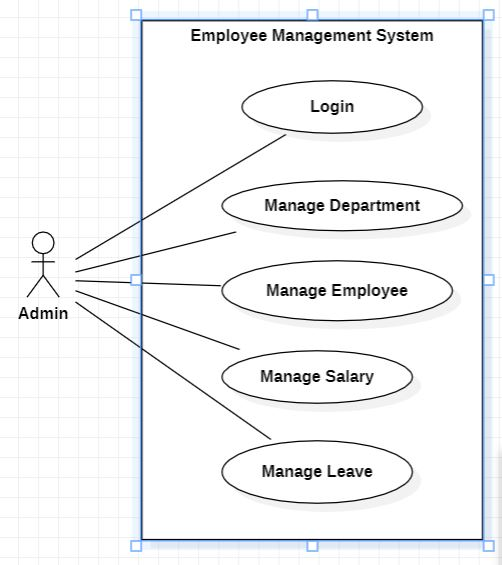
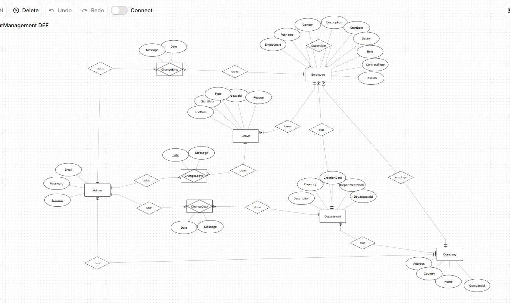
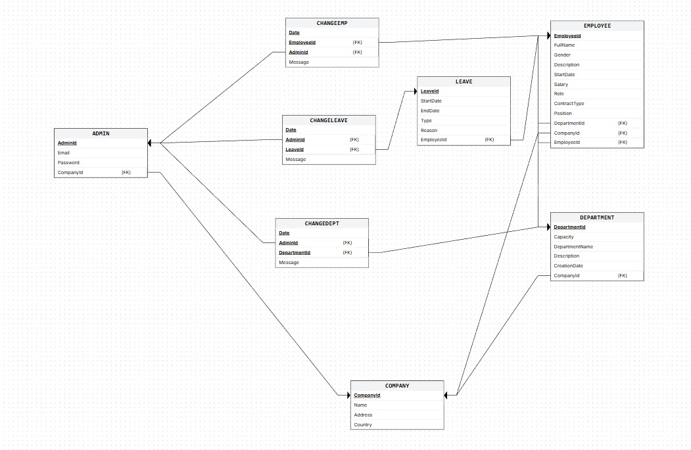
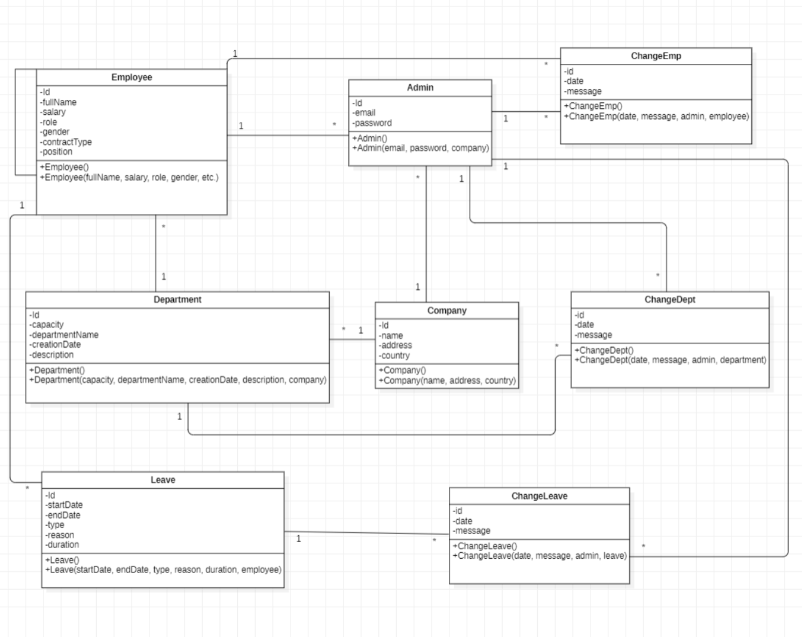

# Employee Management System

Managing employee information using spreadsheets often leads to problems such as data loss, duplication, difficulty locating specific employees, and inefficiency when handling large amounts of information. As companies grow, spreadsheet-based management becomes increasingly complex and time-consuming

The **Employee Management System** is a full‑stack application designed to help companies manage employees, departments, salaries, leave records, and administrative change logs in a structured and efficient way. It centralizes HR operations, improves data accuracy, and provides clear visibility into workforce activities through dashboards and analytics.

---

## Project Description

This system allows administrators to:

- Register a company and create an admin account
- Log in securely
- Manage employees, departments, salaries, and leave records
- Track all administrative changes (audit logs)
- View dashboards with real‑time statistics
- Generate structured data for reporting and decision‑making

The goal is to reduce manual work, improve organization, and streamline HR workflows.

---

## Technology Selection

The technology stack for the **Employee Management System** has been selected to ensure full compliance with the course curriculum, which mandates a Java-based environment. The selection prioritizes technologies that support the required **DevOps practices** (CI/CD, Containerization) and **Software Engineering methodologies** (Agile/Scrum).

### Frontend
*   **Technology:** JavaFX
*   **Rationale:** As the project requires a standalone application and the course mandates **Java** for all compulsory assignments, JavaFX is the optimal choice. It allows for the development of a strictly typed, object-oriented interface. This ensures seamless integration with our backend logic and enables the creation of the five required views (Home, Employee, Department, Leave, Salary) without relying on external web frameworks unsupported by the course technical staff.

### Backend
*   **Language:** Java (JDK 17 or higher)
*   **Build Automation:** Maven
*   **Rationale:** Java is the core language for this course. **Maven** is selected for build automation and dependency management, as explicitly required for the Sprint 2 deliverables. This choice supports "Professional Development" standards by separating source code from build configurations and managing libraries like JUnit.

### Database
*   **Technology:** MariaDB (Relational Database)
*   **Rationale:** The data managed by this system (Employees, Departments, Leave...) is highly structured and formalized. According to data modeling principles, a **Relational Database** is the correct choice for structured data where integrity and consistency are critical. A relational model allows us to implement the ER diagrams and cardinality constraints (e.g., 1:M relationships) designed in the logical design phase.

### DevOps & Tools
To meet the course's strict **DevOps** and **Quality Assurance** requirements, the following tools are integrated into the stack:

| Category | Tool | Rationale                                                                                           |
| :--- | :--- |:----------------------------------------------------------------------------------------------------|
| **Version Control** | **Git & GitHub** | Essential for collaborative development.                                                            |
| **CI/CD** | **Jenkins** | Automates the build and testing process to ensure the software remains in a releasable state.       |
| **Containerization** | **Docker** | Containerizes the application to ensure consistency across development and production environments. |
| **Testing** | **JUnit** | The standard framework for Java unit testing.                                                       |
| **Modeling** | **StarUML (v5.0.1)** | The specific tool for creating Use Case and Class diagrams.                                         |

---
## Architecture Design
The system follows a modular architecture with clear separation of concerns:

### **1. Entity Layer**
Represents the database tables using JPA annotations.  
Entities include:

- Company
- Admin
- Department
- Employee
- Leave
- ChangeDept
- ChangeEmp
- ChangeLeave

### **2. DAO Layer**
Each entity has a dedicated DAO responsible for:

- CRUD operations
- Relationship queries
- Sorting and filtering
- Audit log retrieval

### **3. Database Layer**
MariaDB stores all persistent data with foreign‑key relationships ensuring consistency.

---
## Use Case Diagram
The use case diagram shows the main interactions between the Admin and the system.  
The Admin can manage employees, departments, salaries, leave records, and view dashboards and change logs.

The use‑case diagram shows the **Admin** as the main actor.

The Admin can:

- Register / Sign In
- Manage Employees
- Manage Departments
- Manage Salaries
- Manage Leave Records
- View Dashboards
- Track Change Logs

This reflects the system’s focus on centralized HR management.

--- 
## ER Diagram
The ER diagram illustrates the core structure of the Employee Management System, showing how entities such as Company, Department, Employee, Leave, and Admin relate to each other.  
It also includes associative entities (ChangeEmp, ChangeDept, ChangeLeave) used for audit logging.

The ER diagram models the core structure of the system:

- **Company** has many **Departments**, **Employees**, and **Admins**
- **Department** has many **Employees**
- **Employee** takes many **Leaves**
- **Admin** performs changes on Employees, Departments, and Leaves
- **ChangeEmp**, **ChangeDept**, and **ChangeLeave** act as **audit logs**
- **Supervisor** is a recursive relationship where an employee may supervise others

This structure ensures both operational data and administrative actions are tracked.

---
## Relational Schema
The relational schema represents the physical database structure in MariaDB.  
It includes primary keys, foreign keys, and table relationships for all entities in the system.

---
## Class Diagram
The class diagram models the core domain classes and their relationships within the Employee Management System.

- **Company** is the central class, linked to Department, Employee, and Admin (one-to-many)
- **Admin** manages the system and generates change log records on every modification
- **Department** belongs to a Company and contains many Employees
- **Employee** belongs to one Department and one Company; supports a recursive supervisor relationship
- **Leave** is linked to one Employee; an Employee can have many Leave records
- **ChangeEmp**, **ChangeDept**, and **ChangeLeave** are audit log classes created whenever an Admin modifies an Employee, Department, or Leave — storing the date, message, and the actor who made the change

---
## Key Features

### **1. Admin Registration & Login**
- Create a company and admin account
- Secure authentication
- Clean UI for onboarding

### **2. Dashboard Overview**
- Total employees
- Active employees
- Employees on leave
- Department statistics
- Recent activities
- Salary summaries

### **3. Employee Management**
- Add, edit, delete employees
- Filter by department, gender, contract type
- View detailed employee profiles

### **4. Department Management**
- Create and manage departments
- Track capacity and employee count
- View department‑level analytics

### **5. Leave Management**
- Add leave records
- View leave history
- Track leave types and durations
- Manage approvals

### **6. Salary Management**
- View total monthly payroll
- Average salary
- Highest salary
- Salary breakdown per employee

### **7. Audit Logging (Change Tracking)**
Every update to:

- Employees
- Departments
- Leaves

…creates a **ChangeEmp**, **ChangeDept**, or **ChangeLeave** record with:

- Timestamp
- Admin who made the change
- Message describing the update

This ensures full transparency and traceability.

---

## Language Support

The application is available in **4 languages**: English, Spanish, Persian, and Arabic.

### How to Change Language

1. Log in to the application.
2. Find the **language dropdown** in the top navigation bar.
3. Select your preferred language — the UI updates instantly.

> Arabic and Persian display right-to-left automatically.

### Localization Resources Used

| Category | Tool / Resource |
| :--- | :--- |
| **Translation Review** | Native speakers — dialect validation for Arabic and Persian |
| **Key Management** | IntelliJ IDEA Resource Bundle Editor — edit all language files side-by-side |